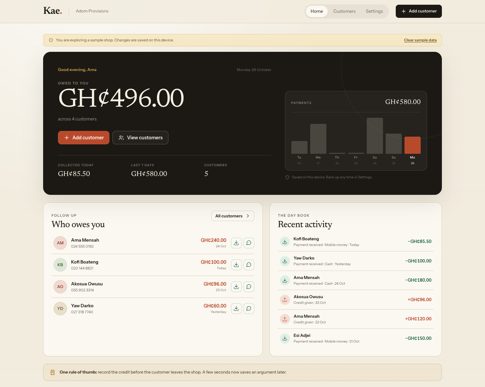
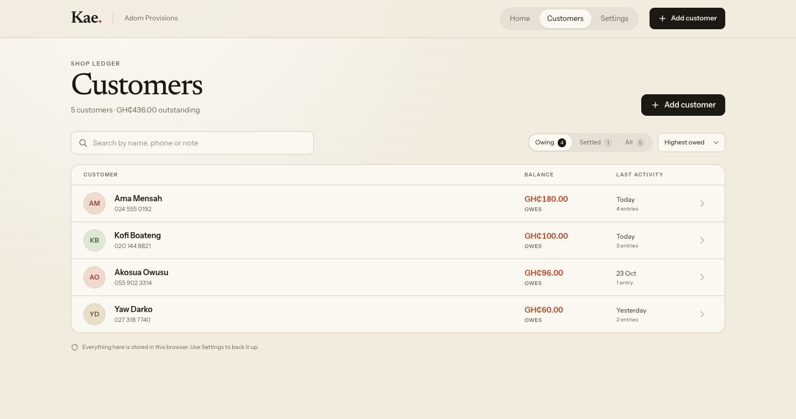
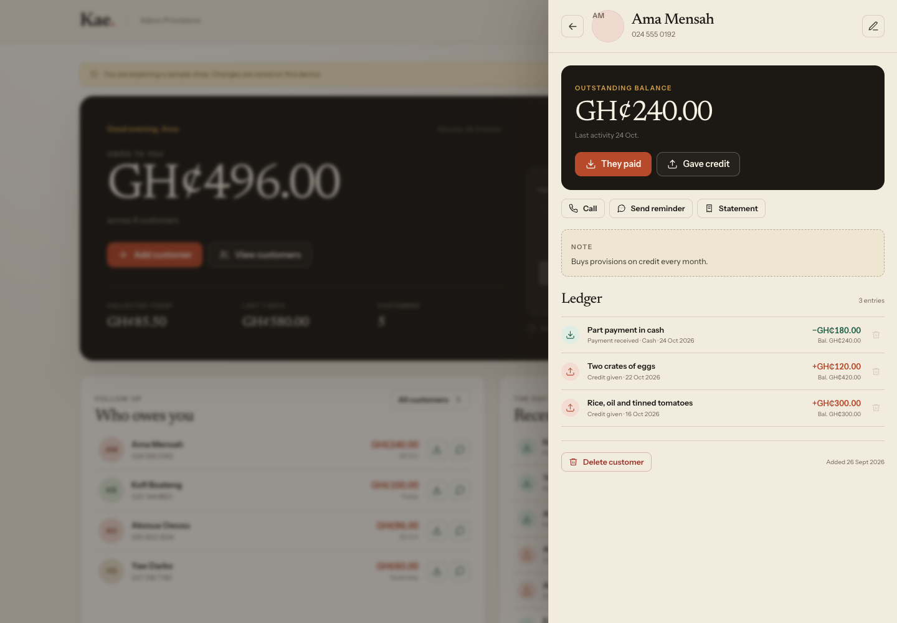
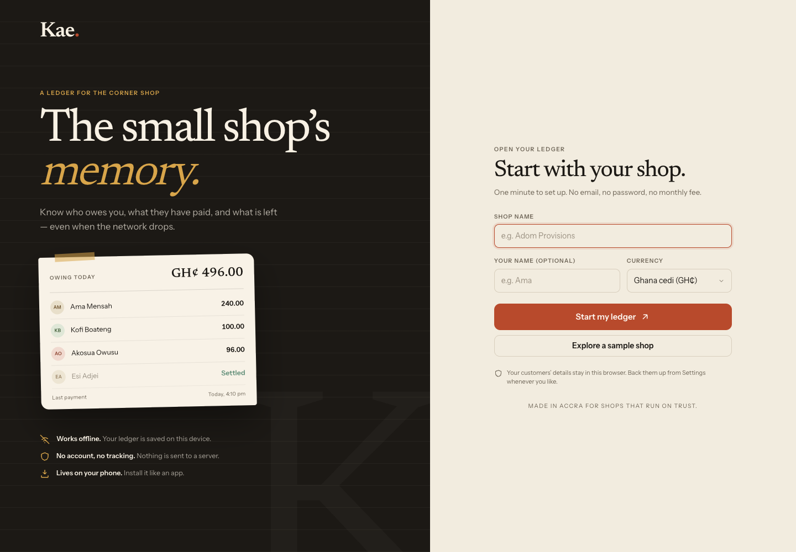
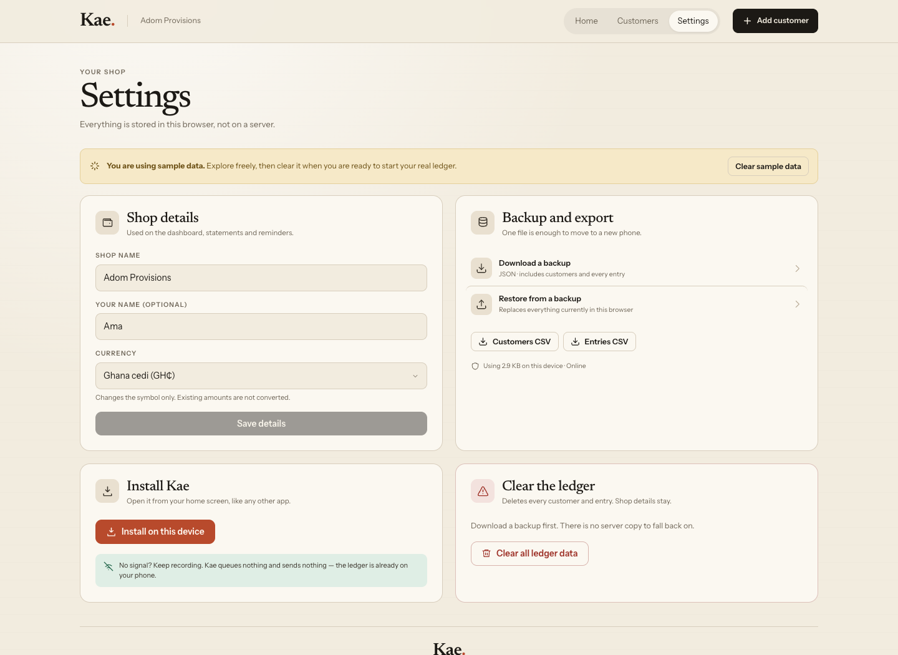

# Kae

**The small shop's memory.**

Kae is an offline-first credit ledger for small shops. Record who took goods on
credit, log part payments, and know exactly who owes what — on one phone, with
no account, no server and no monthly fee.

[**Open the live demo →**](https://pkaycodes.github.io/kae/?demo=1)

[](https://github.com/pkaycodes/kae/actions/workflows/ci.yml)
[](https://github.com/pkaycodes/kae/actions/workflows/deploy.yml)
[](LICENSE)



## Why Kae exists

A neighbourhood provisions shop sells a bag of rice to a regular and writes the
amount in a exercise book. Weeks later the page is full, the handwriting is
unclear, and asking a customer to pay becomes an argument. The shopkeeper does
not need accounting software; they need a reliable memory.

Kae is that memory. It is built around one question — **who owes me, and how
much?** — and works when the network does not.

## What it does

- **A home screen that answers the question.** Total outstanding, money given on
  credit and payments received in the last seven days, and a list of customers
  who still owe.
- **A running ledger per customer.** Every credit and payment is recorded with
  a date, note, and payment method (cash, MoMo, bank or other). Part payments
  update the balance immediately.
- **Reminders without an API.** Tap a customer's WhatsApp button and Kae opens a
  pre-written message with their name, balance and statement — ready to send
  from your own WhatsApp.
- **Statements and exports.** Download a customer statement, the whole customer
  list, or every entry as CSV for Excel or Google Sheets.
- **Backups you control.** Export the full ledger as JSON and import it on a new
  phone. Imports are validated before anything is replaced.
- **Installable and offline.** Kae is a PWA. Add it to the home screen and it
  opens like an app, offline, without an app store.
- **Phone-first design.** Large touch targets, bottom navigation on small
  screens, native dialogs, visible focus states, and reduced-motion support.

The demo link above loads a sample shop, so you can try every screen without
entering data. A real shop starts with a short onboarding and an empty ledger.

| Customers | Customer ledger |
| --- | --- |
|  |  |

| Onboarding | Settings |
| --- | --- |
|  |  |

## Privacy

Everything stays in the browser's `localStorage` on the device. There is no
backend, no account, no sync, no analytics, and no network request in normal
use. The only time Kae leaves the page is when you tap a WhatsApp link, which
opens `wa.me` with a message you can review before sending.

That is a deliberate trade-off: data does not leave the phone, but it also does
not follow you to another phone automatically. Use **Settings → Download
backup** and keep the JSON file somewhere safe.

## Getting started

Requires Node.js 20.19+ or 22.12+ (the project is developed and tested on Node
22).

```bash
git clone https://github.com/pkaycodes/kae.git
cd kae
npm install
npm run dev
```

Open the URL Vite prints. To explore the sample shop locally, append `?demo=1`
to the URL.

### Scripts

| Command | Purpose |
| --- | --- |
| `npm run dev` | Start the Vite dev server |
| `npm run build` | Type-check and build the production bundle |
| `npm run preview` | Serve the production build locally |
| `npm test` | Run the Vitest suite once |
| `npm run test:watch` | Run tests in watch mode |
| `npm run typecheck` | Run TypeScript without emitting |
| `npm run lint` | Run ESLint |

### Tests

The suite covers the money and date logic, CSV escaping (including spreadsheet
formula injection), storage validation, phone normalisation, and the main app
flows: onboarding, adding a customer, recording credit, taking a payment, and
the demo shop. It runs in jsdom with Testing Library.

```bash
npm test
```

CI runs lint, type-check, tests and a production build on every push and pull
request to `main`.

## How it works

Kae is a client-side React application. There is no API to call.

- **Money is stored in integer minor units** (pesewas, kobo, cents) to avoid
  floating-point drift. Formatting happens only at the edge.
- **Dates are local calendar dates** (`YYYY-MM-DD`), so a payment recorded just
  before midnight does not move to the next day.
- **Balances are derived**, not stored: `sum(credits) - sum(payments)` for each
  customer. Editing history can never leave a stale total behind.
- **The database is versioned** under the key `kae.db.v1` and validated on load.
  A corrupt or incompatible value fails visibly instead of silently discarding
  a shop's records.
- **Imports are checked first.** A backup must have a schema version, a shop
  name, unique customer ids, and entries that reference real customers and
  positive integer amounts. The current ledger is only replaced after the entire
  file validates.

### Stack

React 19 · TypeScript · Vite 8 · vite-plugin-pwa (Workbox) · Vitest · Testing
Library · hand-written CSS. The only runtime dependencies are React and two
self-hosted font packages.

### Project layout

```text
src/
  components/   screens, dialogs and forms
  data/         sample shop used by ?demo=1
  hooks/        ledger state, online status, install prompt
  lib/          balances, storage, CSV, dates, phone numbers
  test/         jsdom setup and shared fixtures
  App.tsx       navigation, dialogs and toasts
  index.css     design system and responsive layout
public/         icons and manifest assets
docs/           screenshots used in this README
```

## Deployment

Pushes to `main` are built and deployed to GitHub Pages by
`.github/workflows/deploy.yml`. The Vite base path switches to `/kae/` when
`GITHUB_ACTIONS` is set, so the same source works locally at `/` and on Pages.

To deploy elsewhere, build with `npm run build` and serve `dist/` over HTTPS.
Service workers require HTTPS (or `localhost`).

## Roadmap

Kae is intentionally small. Possible next steps, in rough order:

- A printable receipt or day book page for shops that still keep paper.
- Customer-level reminders for accounts that have been quiet for too long.
- Optional encrypted export, so a backup is safer to send by WhatsApp.
- A settings screen for receipt numbering and shop address.

Multi-device sync and accounts are not on the roadmap. They would turn a
private, offline notebook into a service with servers, passwords and running
costs.

## License

[MIT](LICENSE) © 2026 Papakwame Afrifa Mensa
